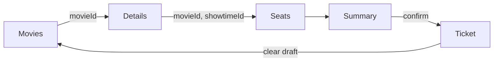

# Booking and navigation flow

Berik's area connects the movie, session and seat choices to a demo booking. `AppNavigation` owns the `NavHost`; screen composables receive data and callbacks. `CinemaViewModel` owns the shared `StateFlow`, so changing screens does not discard a draft selection.

| Route | Required data | Result |
| --- | --- | --- |
| `movies` | sample catalog | choose a film |
| `details/{movieId}` | valid film ID and selected film | choose a showtime |
| `seats/{movieId}/{showtimeId}` | matching film and session IDs | select available seats |
| `summary` | selected film, session and at least one seat | review total and confirm |
| `ticket` | confirmed booking | view, copy or share the demo ticket |

`CinemaRoutes` builds the routes with validated positive IDs. `AppNavigation` checks the selected state against route arguments; if the state is missing or inconsistent, `BookingUnavailableScreen` offers a way back to the catalog.

A confirmed booking is appended to the ViewModel's in-memory list. On returning to Movies, the draft selection is cleared but the booked seat stays occupied for the current app process. There is no network call, payment or persistent storage. The share text explicitly labels the ticket as a demo.

The [manual emulator check](tests/manual-smoke.md) records the visible journey. Unit tests cover route IDs, price formatting and booking rules. Android UI tests cover Summary, copying the ticket number, recovery and the complete journey.
