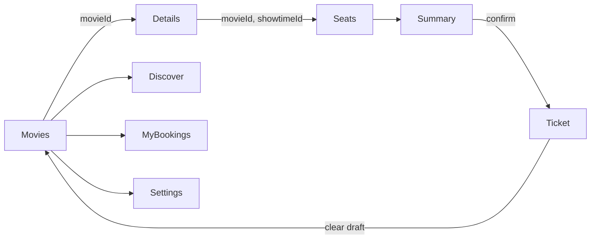

# Booking and navigation flow

Berik's area connects the movie, session and seat choices to a demo booking. `AppNavigation` owns the `NavHost`; screen composables receive data and callbacks. `CinemaViewModel` owns the draft selection in `StateFlow`, while Room stores confirmed bookings. The network Discover screen has a separate ViewModel and does not create cinema sessions.

| Route | Required data | Result |
| --- | --- | --- |
| `movies` | sample catalog | choose a film |
| `details/{movieId}` | valid film ID and selected film | choose a showtime |
| `seats/{movieId}/{showtimeId}` | matching film and session IDs | select available seats |
| `summary` | selected film, session and at least one seat | review total and confirm |
| `ticket` | confirmed booking | view, copy or share the demo ticket |
| `discover` | external film API | browse real movie information and posters |
| `my_bookings` | Room bookings Flow | read, edit seats or delete a saved booking |
| `settings` | DataStore theme Flow | change the saved light or dark theme |

`CinemaRoutes` builds the routes with validated positive IDs. `AppNavigation` checks the selected state against route arguments; if the state is missing or inconsistent, `BookingUnavailableScreen` offers a way back to the catalog.

A confirmed booking is inserted into Room before the Ticket route opens. On returning to Movies, the draft selection is cleared; Room keeps the booking and the seat stays occupied after an app restart. Deleting the booking frees the seat. There is no payment or real cinema account. The share text explicitly labels the ticket as a demo.

The [manual emulator check](tests/manual-smoke.md) records the original journey. Unit tests cover route IDs, price formatting and network loading states. Android tests cover Room CRUD, persisted preferences, Summary, copying the ticket number, recovery and the complete journey.
